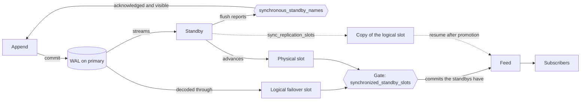

# PostgreSQL replication concepts

> **Generated note.** Written by Claude Code (Claude Opus 5.5) on 23 October 2026 at the request of the author, while
> building #168, and updated with the Aurora findings in #171. It describes the reactive feed as built in those PRs.
> Where it disagrees with the code, the code is right.

How the server's settings and the store work together, so that a subscriber is never given an event that a failover
loses.

## The run-through

What the settings and the store do, in the order they come into play.

1. **Standbys copy the WAL.** Each standby connects to the primary with `primary_conninfo`, receives the primary's
   WAL byte for byte, and replays it. This is physical replication, and it is asynchronous by default: a commit
   doesn't wait for any standby.
2. **Physical slots track each standby.** The primary has one physical slot per standby, created with
   `pg_create_physical_replication_slot()`, by `pg_basebackup -C`, or by a failover manager. Each standby names its
   slot with `primary_slot_name`. The slot doesn't carry the WAL. It is the primary's bookmark for that standby: how
   far the standby has flushed, and so which WAL to keep for it. Streaming works without a slot, but the gate and the
   copy below both need one.
3. **Synchronous commit makes appends durable.** `synchronous_standby_names` names standbys by application name, as
   `FIRST n (…)` or `ANY n (…)`, and the store runs every append with `synchronous_commit = on`. A commit is first
   written to the primary's WAL, then waits until the named standbys have flushed it, and only then is it
   acknowledged and visible to other sessions. The primary learns this from the progress each standby reports over
   its own connection to the primary, not from slots. Flushed means safe on the standby's disk, which is what
   survives a failover. It doesn't mean visible to queries on the standby.
4. **The wait can end early.** If the waiting backend is cancelled or terminated, the primary restarts, or
   `synchronous_standby_names` is emptied, the commit becomes visible on the primary even though the standbys don't
   have it. A failover then loses it, and the next append reuses its position. A subscriber that was given the lost
   event is already past that position, so it also skips the event that reuses it: one phantom event, and one missed.
   With healthy replication the window is milliseconds, because the WAL still reaches the standby a moment later. But
   a wait only lasts long enough to be cut short when the standby is slow, disconnected or cut off, and then the
   window stays open for as long as the standby is away. Those are the same incidents that lead to failovers. A
   failover manager protects only acknowledged commits, and a commit whose wait was cut short never was acknowledged.
5. **The barrier protects catch-up reads.** After a catch-up has read up to the end, it commits a tiny transaction
   that writes one WAL record (`pg_logical_emit_message`) with `synchronous_commit = on`. WAL is sequential, so once
   the synchronous standbys have flushed that record, they have everything the read saw. Only then are the events
   delivered. The read can still see an event whose wait ended early, but the barrier makes sure it isn't delivered
   until the standbys have it. If the barrier's own wait ends early, the subscription fails. The barrier runs only
   when `synchronous_standby_names` is set.
6. **The gate protects live delivery.** Live subscriptions come from logical replication: the feed reads decoded row
   changes through its logical slot, which records how far the feed has got, so the feed resumes there after a
   reconnect. The primary would send a commit to the feed as soon as it is in the primary's own WAL, before any
   standby has it, and before its wait ends. Without the gate, the feed would be ahead of the standbys on every
   commit, not only those whose wait ends early, so a crash at any moment could lose events it had already
   delivered. So the store creates its slot with `failover => true`, and `synchronized_standby_slots` lists the
   standbys' physical slots. The primary then holds each commit back from the feed until every listed slot has passed
   it. Unlike the commit wait, no client can cut this short. It ends only when the slots move forward or the list
   changes.
7. **The copy keeps the feed's place.** Standbys with `sync_replication_slots = on` keep a copy of the feed's slot.
   After a failover, the feed resumes from the copy on the new primary. Without a copy, the feed creates a new slot,
   and subscribers reset and catch up. That is still correct, just slower, so the copy is optional. In our tests a new
   slot's copy became usable about 13 s after the slot was created.
8. **A failover manager ties it together.** PostgreSQL never promotes a standby by itself. The manager must promote
   only a standby that has every acknowledged commit, and that standby must be covered by both
   `synchronous_standby_names` and `synchronized_standby_slots`. The two lists name standbys differently, and nothing
   in PostgreSQL checks that they agree, so the manager should keep them in step.
9. **Visibility order is a separate problem.** It has nothing to do with standbys. The feed can receive a commit
   before queries on the primary can see it, so a catch-up waits until its reads reach the highest position the feed
   has delivered. A new slot can skip a commit that isn't visible yet, so opening one waits on the sequence row.
10. **Aurora needs none of the standby machinery.** Its shared storage makes a commit durable before it is visible,
    and `synchronous_standby_names` is empty, so there is no barrier, gate or copy. The slot lives in the shared
    storage too, so after a writer failover the feed resumes on it from the new writer. The failover option has no
    effect there: a plain slot survives in the same way.

Solid arrows are what happens to every commit. Dotted arrows are the copy, which only matters at a failover.

## Settings for a cluster with standbys

Example values for two standbys named `standby_a` and `standby_b`. The store sets `synchronous_commit = on` on its own
transactions, and creates its slot with `failover => true`, whatever the server says.

| Where   | Setting                                                                                                    | What it does                                                                                |
|---------|------------------------------------------------------------------------------------------------------------|---------------------------------------------------------------------------------------------|
| Primary | `wal_level = logical`                                                                                      | Allows live subscriptions at all.                                                           |
| Primary | `synchronous_standby_names = 'FIRST 1 (standby_a, standby_b)'`                                             | Makes appends and the catch-up barrier wait for the standbys.                               |
| Primary | `SELECT pg_create_physical_replication_slot('standby_a')`, one per standby. A function call, not a setting | Creates the slot that the gate and the copy need.                                           |
| Standby | `primary_slot_name = 'standby_a'`                                                                          | Streams through that slot.                                                                  |
| Primary | `synchronized_standby_slots = 'standby_a, standby_b'`                                                      | The gate. It waits for every listed slot, not a quorum.                                     |
| Standby | `sync_replication_slots = on`                                                                              | The copy, so the feed resumes after a failover instead of resetting. Optional.              |
| Standby | `hot_standby_feedback = on`                                                                                | Required by the copy. Long queries on the standby can then hold back vacuum on the primary. |
| Standby | `wal_level = logical`                                                                                      | Required by the copy.                                                                       |
| Standby | `primary_conninfo = 'host=… user=… dbname=postgres'`                                                       | Required by the copy, which needs a `dbname`.                                               |
| Primary | `max_slot_wal_keep_size = '10GB'`                                                                          | Optional cap on the WAL a slot can hold. A slot past it is invalidated.                     |

Keeping them aligned:

- **Every standby that a failover can promote** has its own physical slot, listed in `synchronized_standby_slots`, and
  is named in `synchronous_standby_names`. Ideally it has the copy on too.
- **A standby whose slot isn't listed** keeps the copy off, because a copy without the gate is unsafe. A standby that
  is never promoted, such as an asynchronous reporting replica, needs neither.
- **The names can differ.** `synchronous_standby_names` uses application names, which default to each standby's
  `cluster_name`. The other settings use slot names. Patroni makes them the same, but nothing requires it, and nothing
  in PostgreSQL checks that the lists agree. A failover manager should own all of them.
- **A listed slot that is missing, invalidated or inactive stalls live subscriptions,** and only the server log says
  why.
- **A failover copies only failover logical slots,** and only to standbys with the copy on. The new primary needs its
  own physical slots for its standbys, and its own `synchronized_standby_slots`.
- **The store connects through one endpoint.** Its data source and its replication connection string must each name a
  single host that always reaches the primary, such as a writer endpoint, a virtual IP, or a proxy. Live
  subscriptions fail if either lists several hosts: Npgsql can't open a replication connection to several hosts, and a
  multi-host data source fails rather than waits while a failover leaves no primary. While the endpoint still reaches
  a standby, as it can for a while during a failover, the feed keeps retrying.

## Aurora assumptions

AWS documents neither of these. The Aurora tests (`tests/DomainBlocks.EventStore.PostgreSQL.Tests.Aurora`) check the
first on Aurora PostgreSQL 17.11.

- **Slots survive a writer failover.** If one didn't, the feed would create a new slot, reset subscribers, and catch
  them up: slower, but nothing missed.
- **Logical decoding sends only commits that the storage has acknowledged,** as queries see only those. The tests
  can't produce the opposite. If it happened, a failover could lose an event that a subscriber already had.
